<div align="center">

# 💻 DJDPatricio Laundry Shop (LaundryClean)

**My C# learning project from my second year of college (2016): a WinForms app that automates transaction recording for a laundry shop.**

![C#][b-lang] ![.NET Framework][b-framework] ![Year][b-year] ![License][b-license]

</div>

---

## 📖 About

This repository contains a WinForms (.NET Framework) desktop application, branded **LaundryClean**, that automates simple transaction recording for a laundry shop business. Staff sign in, record sales of services and inventory items, record purchases from suppliers, and maintain inventory, services, customers, suppliers and employees. All data lives in a MySQL database named `djdpatricio_laundryclean`.

---

## 🔥 Tech Stack & Tools

<p align="center">
  
  
  
  
  <br />
  
  
  
</p>

- **Language and UI:** C# on .NET Framework 4.6.2, Windows Forms (`System.Windows.Forms`, `System.Drawing`)
- **Data access:** ADO.NET with the `MySql.Data` 8.0.33 connector (`MySqlConnection`, `MySqlCommand`, parameterized inline queries)
- **Configuration:** connection string `MySQLConnection` in `App.config`, read through `System.Configuration.ConfigurationManager`
- **Security:** SHA-256 password hashing with `System.Security.Cryptography`
- **Deployment:** ClickOnce publishing with a .NET Framework 4.6.2 bootstrapper (manifest signing is off in the repo; sign with your own certificate when publishing)

<details>
<summary>📦 NuGet packages (<code>packages.config</code>)</summary>

| Package | Version | Why it is there |
| :-- | :-- | :-- |
| MySql.Data | 8.0.33 | MySQL ADO.NET driver (direct dependency) |
| Google.Protobuf | 3.21.9 | dependency of MySql.Data |
| Portable.BouncyCastle | 1.9.0 | dependency of MySql.Data |
| K4os.Compression.LZ4 | 1.3.5 | dependency of MySql.Data |
| K4os.Compression.LZ4.Streams | 1.3.5 | dependency of MySql.Data |
| K4os.Hash.xxHash | 1.0.8 | dependency of MySql.Data |
| System.Buffers | 4.5.1 | dependency of MySql.Data |
| System.IO.Pipelines | 5.0.2 | dependency of MySql.Data |
| System.Memory | 4.5.5 | dependency of MySql.Data |
| System.Numerics.Vectors | 4.5.0 | dependency of MySql.Data |
| System.Runtime.CompilerServices.Unsafe | 6.0.0 | dependency of MySql.Data |
| System.Threading.Tasks.Extensions | 4.5.4 | dependency of MySql.Data |

</details>

---

## ✨ Features

* **Database:** Inline parameterized queries (ADO.NET), query pagination (`LIMIT`/`OFFSET` with a rows-per-page selector), search, soft delete with audit columns, indexed foreign keys across 13 tables
* **Design:** Object-Oriented Programming (OOP)
* **Components:** Custom-built `CustomTextbox` user control with label and placeholder text
* **Security & Data:** SHA-256 password hashing, employee photos saved to the database, smart resource management (`using` blocks for connections, commands, streams and forms)
* **User Interface:** Intuitive sidebar navigation, modal entry forms, splash screen

---

## 📚 Modules

1. 👋 **Login**
2. 🔑 **Change Password**
3. 💰 **Sales** (inventory items and services, other cost, tax, discount, grand total)
4. 🛒 **Purchase** (inventory bought from suppliers)
5. 📦 **Inventory** (current price and price history)
6. 🛠️ **Services** (current price)
7. 🤝 **Suppliers**
8. 👤 **Customers**
9. 🧑‍💼 **Employees** (position, photo and login details)

---

## 🗂️ Project Structure

```text
djdpatricio_2016-csharp-winforms/
├── DJDPatricio.LaundryShop.sln
├── DJDPatricio.LaundryShop.App/
│   ├── Class/            ItemDisplay, ItemValue, TransactionDeleted, UserDetails
│   ├── Forms/            Splash, Login, Main, Sales, Purchase, Inventory, Services,
│   │                     Customers, Suppliers, Employees, Change Password, amount dialogs
│   ├── Helper/           StaticFunctions (SHA-256), UserControls/CustomTextbox
│   ├── Properties/       assembly info, resources, settings
│   ├── Resources/        logo and icon images
│   ├── App.config        MySQL connection string
│   ├── packages.config   NuGet packages
│   └── Program.cs        splash screen, then login, then main window
├── docs/screenshots/     system_image_1.png to system_image_11.png
├── LICENSE
└── README.md
```

---

## 📄 Release Documentation

For detailed release notes and documentation, please refer to the [v1.0 release](https://github.com/djdpatricio/djdpatricio_2016-csharp-winforms/releases/tag/v1.0).

---

## 🛠 Requirements

- Windows with .NET Framework 4.6.2 or higher
- MySQL 8.0 or higher (the database script was exported from MySQL 8.0.36)
- Visual Studio 2017 or later with the **.NET desktop development** workload

---

## 🔑 Default Login Credentials

After installation, use these credentials to log into the application for the first time:

* **Username:** `sa`
* **Password:** `SecretPassword_00`

---

## ▶️ How to Run

1. Clone the repo:
   ```bash
   git clone https://github.com/djdpatricio/djdpatricio_2016-csharp-winforms.git
   ```
2. Execute the database script: [Database Script](https://github.com/djdpatricio/djdpatricio_2016-csharp-winforms/releases/download/v1.0/djdpatricio_laundryclean.sql) 📄. It creates the `djdpatricio_laundryclean` database, its tables and the default `sa` account.
   ```bash
   mysql -u root -p < djdpatricio_laundryclean.sql
   ```
3. Update the connection string in `DJDPatricio.LaundryShop.App/App.config` to match your connection details.
    ```xml
    <connectionStrings>
        <add name="MySQLConnection" connectionString="Server=localhost;Port=3306;Database=djdpatricio_laundryclean;Uid=root;Pwd=root_password;" providerName="MySql.Data.MySqlClient" />
    </connectionStrings>
    ```
4. Open `DJDPatricio.LaundryShop.sln` in Visual Studio. NuGet restores `MySql.Data` and its dependencies on the first build.
5. Press **F5** to build and run, then sign in with the default credentials above.
6. Optional: use **Build → Publish** to produce a ClickOnce installer. The repo ships no signing certificate, so to sign the manifests open **Project Properties → Signing**, tick **Sign the ClickOnce manifests** and pick your own certificate (or create a test certificate there). Keep that `.pfx` out of git; `.gitignore` already excludes `*.pfx`.

---

## 🖼️ Gallery

Here are some screenshots of the DJDPatricio Laundry Shop Application in action:

<table>
  <tr>
    <td align="center" width="50%">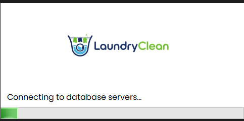<br /><sub>Splash screen</sub></td>
    <td align="center" width="50%">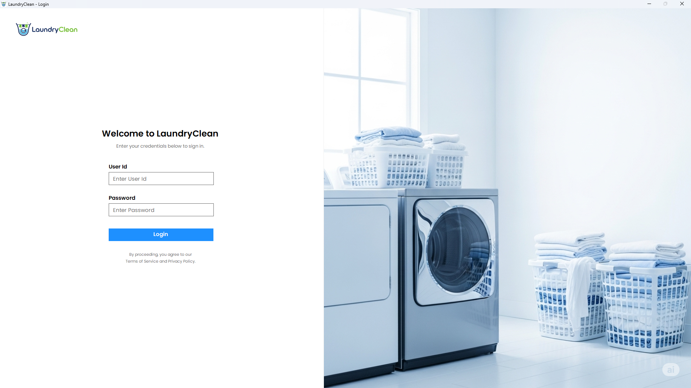<br /><sub>Login</sub></td>
  </tr>
  <tr>
    <td align="center" width="50%">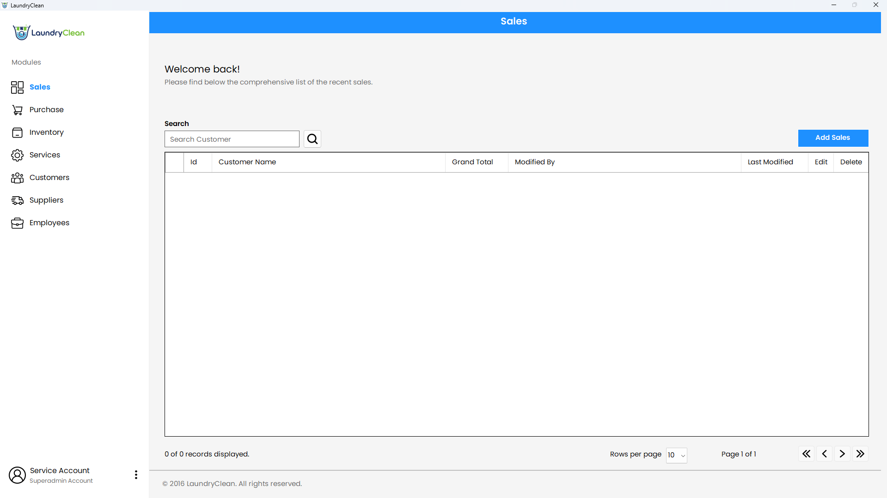<br /><sub>Sales list with search and pagination</sub></td>
    <td align="center" width="50%">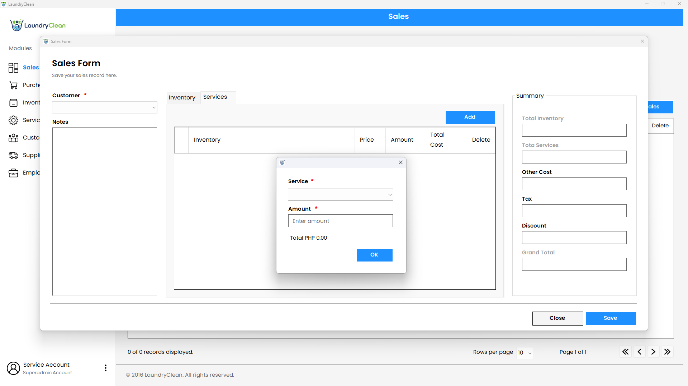<br /><sub>Sales form</sub></td>
  </tr>
  <tr>
    <td align="center" width="50%">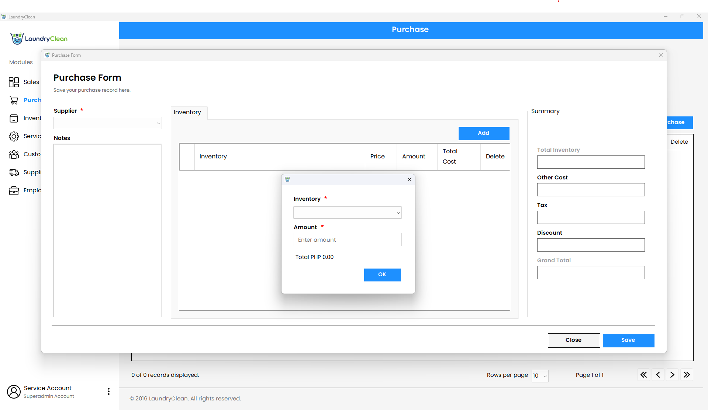<br /><sub>Purchase form</sub></td>
    <td align="center" width="50%">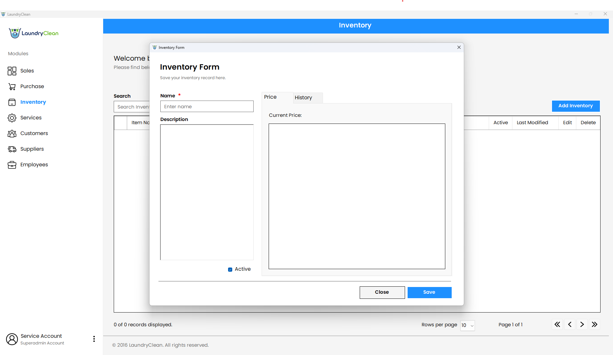<br /><sub>Inventory form</sub></td>
  </tr>
  <tr>
    <td align="center" width="50%">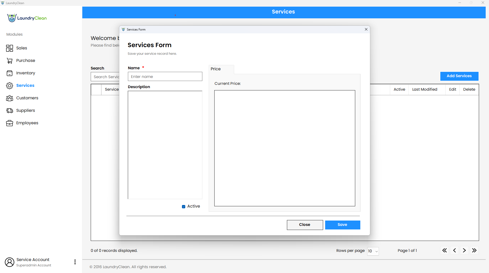<br /><sub>Services form</sub></td>
    <td align="center" width="50%">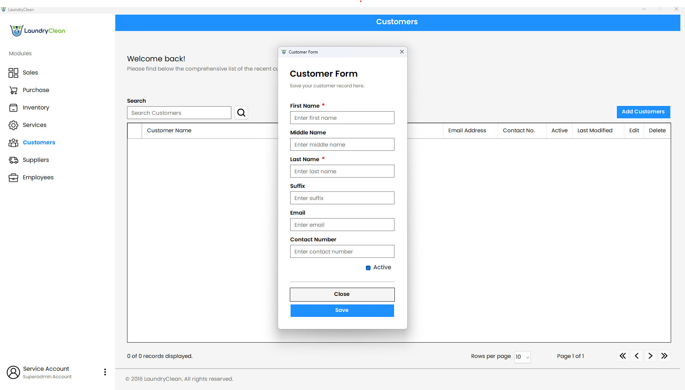<br /><sub>Customer form</sub></td>
  </tr>
  <tr>
    <td align="center" width="50%">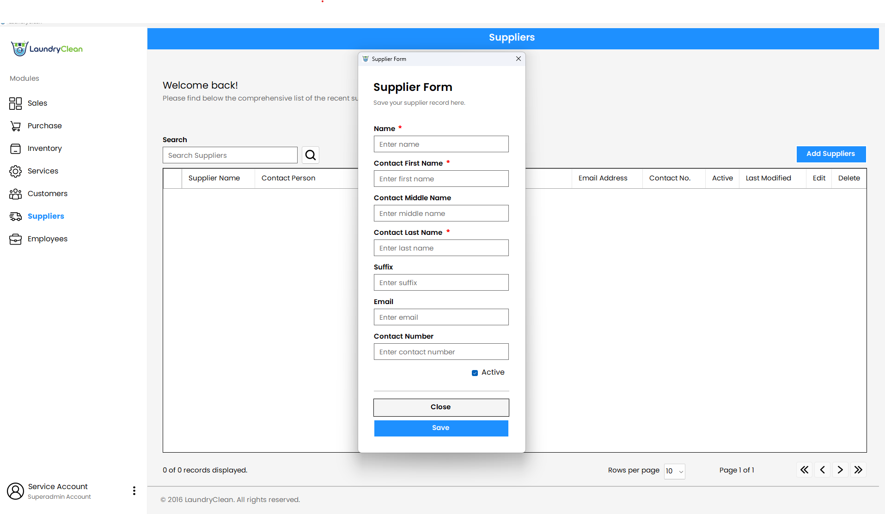<br /><sub>Supplier form</sub></td>
    <td align="center" width="50%">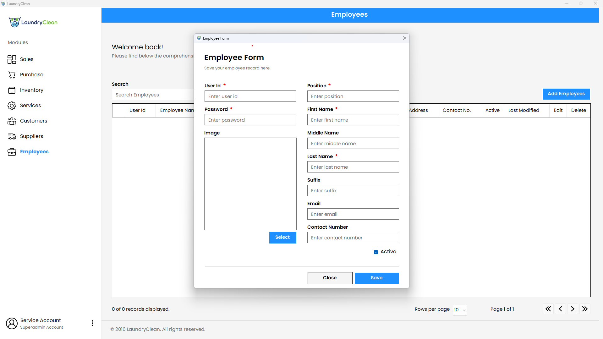<br /><sub>Employee form</sub></td>
  </tr>
  <tr>
    <td align="center" colspan="2">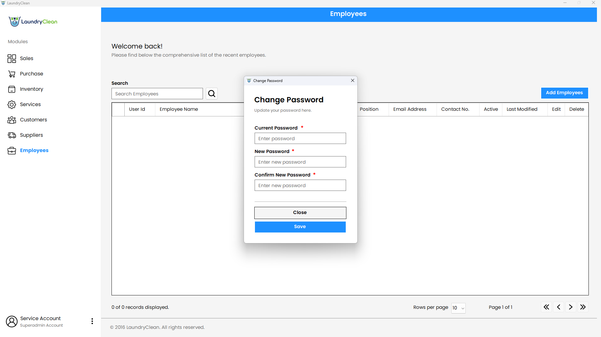<br /><sub>Change password</sub></td>
  </tr>
</table>

---

## 📄 License

This project is licensed under the [MIT License](LICENSE).

---

<div align="center">

Made by [Dennis Jayvee Patricio](https://github.com/djdpatricio)

</div>

[b-lang]: https://img.shields.io/badge/language-C%23-239120?logo=data:image/svg%2Bxml;base64,PHN2ZyB2aWV3Qm94PSIwIDAgMjQgMjQiIHhtbG5zPSJodHRwOi8vd3d3LnczLm9yZy8yMDAwL3N2ZyI%2BPHBhdGggZmlsbD0iI2ZmZiIgZD0iTTEuMTk0IDcuNTQzdjguOTEzYzAgMS4xMDMuNTg4IDIuMTIyIDEuNTQ0IDIuNjc0bDcuNzE4IDQuNDU2YTMuMDg2IDMuMDg2IDAgMCAwIDMuMDg4IDBsNy43MTgtNC40NTZhMy4wODcgMy4wODcgMCAwIDAgMS41NDQtMi42NzRWNy41NDNhMy4wODQgMy4wODQgMCAwIDAtMS41NDQtMi42NzNMMTMuNTQ0LjQxNGEzLjA4NiAzLjA4NiAwIDAgMC0zLjA4OCAwTDIuNzM4IDQuODdhMy4wODUgMy4wODUgMCAwIDAtMS41NDQgMi42NzNabTUuNDAzIDIuOTE0djMuMDg3YS43Ny43NyAwIDAgMCAuNzcyLjc3Mi43NzMuNzczIDAgMCAwIC43NzItLjc3Mi43NzMuNzczIDAgMCAxIDEuMzE3LS41NDYuNzc1Ljc3NSAwIDAgMSAuMjI2LjU0NiAyLjMxNCAyLjMxNCAwIDEgMS00LjYzMSAwdi0zLjA4N2MwLS42MTUuMjQ0LTEuMjAzLjY3OS0xLjYzN2EyLjMxMiAyLjMxMiAwIDAgMSAzLjI3NCAwYy40MzQuNDM0LjY3OCAxLjAyMy42NzggMS42MzdhLjc2OS43NjkgMCAwIDEtLjIyNi41NDUuNzY3Ljc2NyAwIDAgMS0xLjA5MSAwIC43Ny43NyAwIDAgMS0uMjI2LS41NDUuNzcuNzcgMCAwIDAtLjc3Mi0uNzcyLjc3MS43NzEgMCAwIDAtLjc3Mi43NzJabTEyLjM1IDMuMDg3YS43Ny43NyAwIDAgMS0uNzcyLjc3MmgtLjc3MnYuNzcyYS43NzMuNzczIDAgMCAxLTEuNTQ0IDB2LS43NzJoLTEuNTQ0di43NzJhLjc3My43NzMgMCAwIDEtMS4zMTcuNTQ2Ljc3NS43NzUgMCAwIDEtLjIyNi0uNTQ2di0uNzcySDEyYS43NzEuNzcxIDAgMSAxIDAtMS41NDRoLjc3MnYtMS41NDNIMTJhLjc3Ljc3IDAgMSAxIDAtMS41NDRoLjc3MnYtLjc3MmEuNzczLjc3MyAwIDAgMSAxLjMxNy0uNTQ2Ljc3NS43NzUgMCAwIDEgLjIyNi41NDZ2Ljc3MmgxLjU0NHYtLjc3MmEuNzczLjc3MyAwIDAgMSAxLjU0NCAwdi43NzJoLjc3MmEuNzcyLjc3MiAwIDAgMSAwIDEuNTQ0aC0uNzcydjEuNTQzaC43NzJhLjc3Ni43NzYgMCAwIDEgLjc3Mi43NzJabS0zLjA4OC0yLjMxNWgtMS41NDR2MS41NDNoMS41NDR2LTEuNTQzWiIvPjwvc3ZnPg==&logoColor=white
[b-framework]: https://img.shields.io/badge/.NET%20Framework-4.6.2-512BD4?logo=dotnet&logoColor=white
[b-year]: https://img.shields.io/badge/year-2016-informational
[b-license]: https://img.shields.io/badge/license-MIT-yellow
